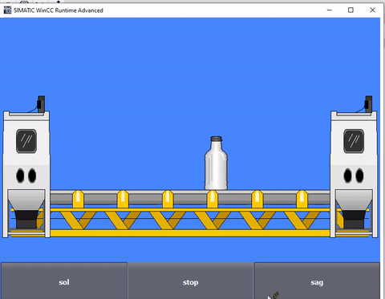
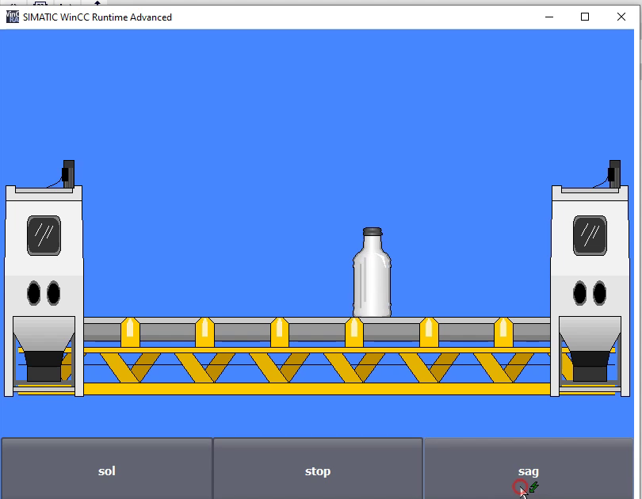
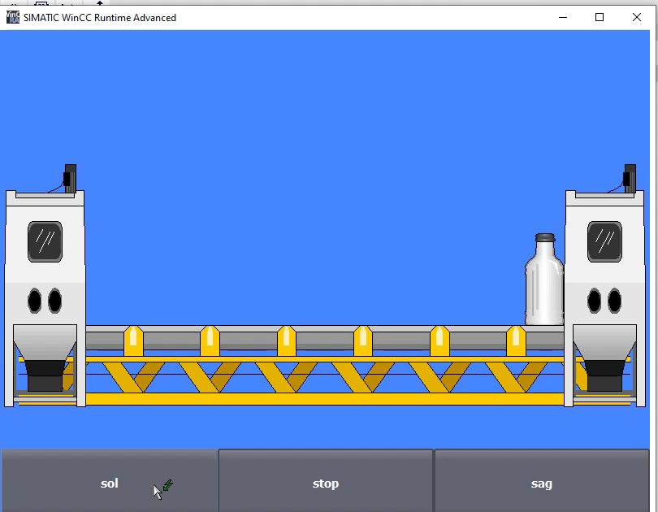
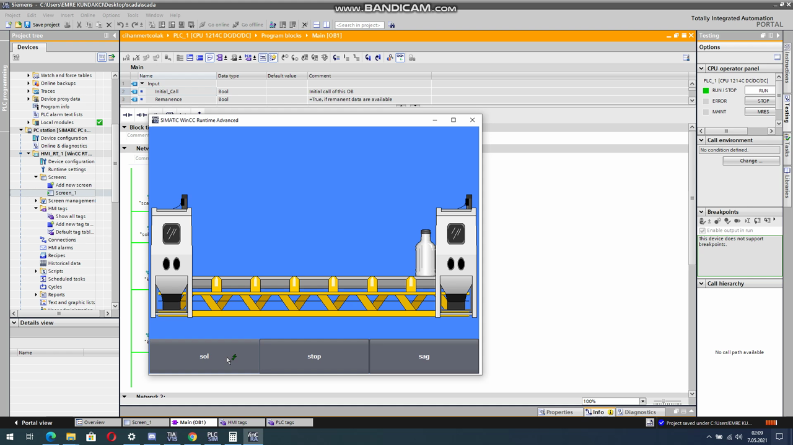

# 01 · S7-1200 Konveyör SCADA Simülasyonu



Siemens **TIA Portal V15** ile hazırlanmış, **S7-1200 PLC** ve **WinCC Runtime Advanced** kullanan bir konveyör kontrol ve izleme (SCADA) projesi. Operatör, HMI ekranındaki **sol / stop / sağ** butonlarıyla bandın yönünü seçer. Ürün (şişe) bant üzerinde iki istasyon arasında hareket eder.

| Özellik | Değer |
|---|---|
| PLC | Siemens CPU S7-1200 **1214C DC/DC/DC** |
| Yazılım | TIA Portal V15 (`.ap15`), PLCSIM |
| HMI / SCADA | WinCC Runtime Advanced (PC Station) |
| Ekran çözünürlüğü | 800 x 600 |
| İşletim sistemi | Windows 8.1 (6.3.9600) |
| Kayıt tarihi | Mayıs 2021 |

## Ekran görüntüleri

| Bekleme | Ürün taşıma |
|---|---|
|  |  |

TIA Portal genel görünümü (PLC programı, HMI ekranı ve PLCSIM birlikte):



## Klasör yapısı

```
01_SCADA_Konveyor_S7-1200/
├── proje/
│   ├── scada.rar        # TIA Portal V15 orijinal projesi (açmak için TIA Portal V15+ gerekir)
│   └── scada.mp4        # Çalışma videosu
├── kod/
│   ├── FB_Konveyor.scl  # Yön kontrol mantığının SCL karşılığı (anlatım amaçlı)
│   └── PLC_Tags.csv     # Örnek tag tablosu
└── gorseller/           # Videodan alınan ekran görüntüleri
```

## Çalışma mantığı

1. **sol** butonu: Bant sola döner, ürün sol istasyona taşınır.
2. **sağ** butonu: Bant sağa döner, ürün sağ istasyona taşınır.
3. **stop** butonu: Bant durur.
4. İki yön aynı anda aktif olamaz (yazılımsal kilitleme). Gerçek sahada buna kontaktör kilitlemesi de eklenir.
5. Ürünün konumu bir sayaçla HMI'daki şişe nesnesinin X koordinatına bağlanır. Ürün uç noktaya geldiğinde bant durur.

> Not: `kod/` klasöründeki SCL dosyası, projedeki ladder (LAD) mantığının okunabilir bir karşılığıdır. Orijinal program `proje/scada.rar` içindedir.
