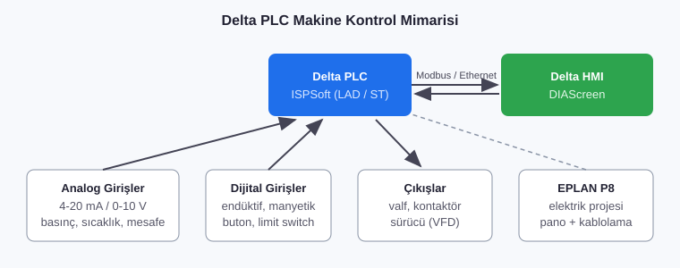

# 02 · Delta PLC ile Makine Programlama ve HMI Tasarımı

**Firma:** ONTAS Makina · **Pozisyon:** Mekatronik Mühendisi · **Tarih:** Ekim 2021 - Kasım 2025



## Yapılan işler
- **Delta ISPSoft** ile makine PLC programlarının yazılması ve devreye alınması
- **DIAScreen** ile operatör HMI ekranlarının tasarımı: manuel/otomatik mod, reçete, alarm ve sayaç ekranları
- Analog sensör verilerinin (4-20 mA / 0-10 V) okunması, ölçeklenmesi ve filtrelenmesi
- Makine çevrimlerinin adım (step/sekans) mantığıyla programlanması
- Makinelerin elektrik projelerinin **EPLAN Electric P8** ile hazırlanması (bkz. [07_EPLAN_Kumanda_Devreleri](../07_EPLAN_Kumanda_Devreleri))

## Kod örnekleri
| Dosya | Açıklama |
|---|---|
| [`kod/FB_AnalogOlcek.st`](kod/FB_AnalogOlcek.st) | Ham analog değeri mühendislik birimine çevirme, hareketli ortalama filtre, kablo kopuk alarmı |
| [`kod/FB_MakineSekans.st`](kod/FB_MakineSekans.st) | Adım tabanlı otomatik çevrim: besleme, sıkma, işlem, boşaltma |

> Firma projeleri gizli olduğundan bu klasördeki kodlar, kullandığım yöntemleri gösteren **genelleştirilmiş örneklerdir**. Delta ISPSoft'un IEC 61131-3 Structured Text (ST) editörüyle uyumludur.

## HMI ekran yapısı (DIAScreen)
```
Ana Ekran ─┬─ Otomatik (çevrim durumu, adım no, sayaç)
           ├─ Manuel (tek tek silindir / motor kontrolü)
           ├─ Reçete (ürün bazlı parametreler)
           ├─ Alarm (aktif + geçmiş alarmlar)
           └─ Ayarlar (analog kalibrasyon, şifre seviyeleri)
```
