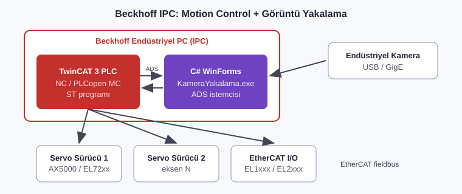

# 03 · Beckhoff TwinCAT 3 Motion Control ve IPC Uygulamaları

**Firma:** ONTAS Makina · **Pozisyon:** Mekatronik Mühendisi



## Yapılan işler
- **Beckhoff IPC** üzerinde **TwinCAT 3** ile servo eksen kontrolü (PLCopen Motion: `MC_Power`, `MC_Home`, `MC_MoveAbsolute`, `MC_Jog`, `MC_Reset`)
- Aynı IPC üzerinde çalışan **C# WindowsFormsApp** ile kamera görüntüsü yakalama ve PLC ile **ADS** üzerinden haberleşme
- PLC'nin "fotoğraf çek" tetiklemesi → C# uygulamasının görüntüyü kaydetmesi → sonucun PLC'ye geri yazılması

## Kod örnekleri
| Dosya | Açıklama |
|---|---|
| [`kod/FB_EksenKontrol.st`](kod/FB_EksenKontrol.st) | Tc2_MC2 ile tek eksen: enable, homing, mutlak pozisyon, jog, hata reset |
| [`kod/KameraYakalama/Form1.cs`](kod/KameraYakalama/Form1.cs) | WinForms: ADS ile PLC tetiklemesini dinler, kameradan kare yakalar ve kaydeder |

> Kodlar, firma projesinden bağımsız hazırlanmış **temsili örneklerdir**.

## PLC ↔ PC haberleşme akışı
```
PLC (TwinCAT)                          WinForms (C#, ADS port 851)
──────────────                         ───────────────────────────
GVL.bKameraTetik := TRUE  ───────────► bildirim (AddDeviceNotification)
                                        kameradan kare yakala, diske yaz
GVL.bKameraTamam  ◄─────────────────── WriteValue(true)
GVL.bKameraTetik := FALSE
```
