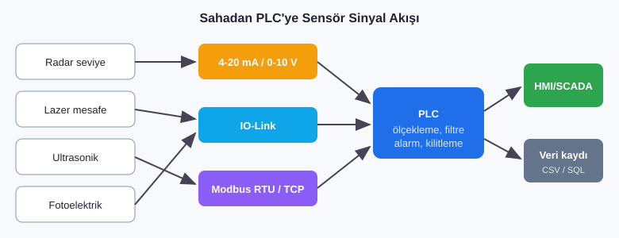

# 04 · Endüstriyel Sensör Entegrasyonu ve Saha Çözümleri

**Firma:** SENSTEK Endüstriyel · **Pozisyon:** İş Geliştirme Mühendisi · **Tarih:** Aralık 2025 - Nisan 2026

## Yapılan işler
- Üretim tesislerinde **saha analizi** yaparak müşteri ihtiyacına uygun sensör çözümleri önermek: radar, lazer, ultrasonik, fotoelektrik
- Sensörlerin **PLC entegrasyonu**: kablolama, parametre ayarı, devreye alma
- **Analog sinyal işleme** (4-20 mA, 0-10 V): ölçekleme, filtreleme, kalibrasyon
- **Modbus RTU/TCP** ve **IO-Link** ile dijital haberleşme senaryoları kurmak
- Üretim hatlarındaki darboğazları sahada inceleyip **duruş sürelerini azaltan** sensör ve görüntü işleme çözümleri geliştirmek

## Kod örnekleri
| Dosya | Açıklama |
|---|---|
| [`kod/FC_Analog_4_20mA.scl`](kod/FC_Analog_4_20mA.scl) | S7-1200/1500 için 4-20 mA ölçekleme ve NAMUR NE43 hata tespiti |
| [`kod/modbus_sensor_okuma.py`](kod/modbus_sensor_okuma.py) | Modbus RTU/TCP sensörden periyodik okuma ve CSV kaydı (pymodbus) |
| [`kod/iolink_notlar.md`](kod/iolink_notlar.md) | IO-Link sensör entegrasyonu kontrol listesi |

## Örnek uygulama senaryoları
| Problem | Sensör çözümü | Kazanç |
|---|---|---|
| Silo seviyesi manuel kontrol ediliyor | Radar seviye sensörü (4-20 mA) → PLC → HMI trend | Seviye sürekli izlenir, eksik malzeme kaynaklı duruş önlenir |
| Bantta ürün sıkışması geç fark ediliyor | Lazer mesafe ve fotoelektrik sensörler, sıkışma zaman aşımı | Sıkışma erken yakalanır, hat duruşu kısalır |
| Sıvı tankında köpük yüzünden yanlış ölçüm | Ultrasonik yerine radar (köpükten daha az etkilenir) | Ölçüm kararlı hale gelir |
| Ürün varyantı yanlış seçiliyor | IO-Link renk/kontrast sensörü, reçete kontrolü | Hatalı üretim azalır |
