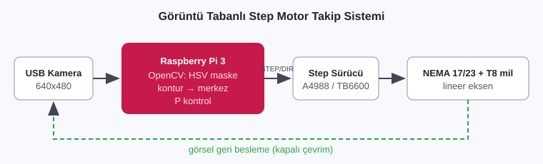

# 05 · Raspberry Pi ile Görüntü İşleme ve Step Motor Kontrolü

**Firma:** IKIA Enerji Mühendislik · **Tarih:** Haziran 2021 - Ekim 2021 · İzmir



## Yapılan işler
- **Raspberry Pi 3** üzerinde **Python + OpenCV** ile kameradan nesne/renk tespiti
- Tespit edilen nesnenin görüntü merkezine göre sapmasını hesaplayıp **step motor** ile takip etmek (kapalı çevrim konumlama)
- A4988/DRV8825 tipi sürücü ile STEP/DIR kontrolü ve mikro adım ayarı
- [06 · Kartezyen Robot](../06_Kartezyen_Robot_150x100x50) mekanik tasarımıyla birlikte yürütüldü

## Kod
| Dosya | Açıklama |
|---|---|
| [`kod/step_motor.py`](kod/step_motor.py) | STEP/DIR sürücü sınıfı: ivmelenme rampası, mm ↔ adım dönüşümü, limit switch ile homing |
| [`kod/renk_takip.py`](kod/renk_takip.py) | HSV renk maskesiyle nesne tespiti; merkezden sapmaya göre P kontrollü eksen takibi |

```bash
sudo apt install python3-opencv python3-rpi.gpio
python3 kod/renk_takip.py --renk kirmizi
```

## Bağlantı (BCM pin)
| Sinyal | Pi pini | Sürücü |
|---|---|---|
| STEP | GPIO 20 | STEP |
| DIR | GPIO 21 | DIR |
| ENABLE | GPIO 16 | EN (aktif LOW) |
| Limit switch | GPIO 26 | NO kontak, GND'ye (dahili pull-up) |
