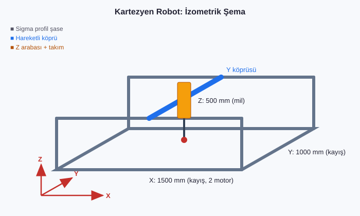

# 06 · Kartezyen Kinematik Sistem Tasarımı (150 x 100 x 50 cm)

**Firma:** IKIA Enerji Mühendislik · **Araçlar:** SolidWorks (parça, montaj, teknik resim)

## Kapsam
- **150 x 100 x 50 cm** çalışma alanına sahip 3 eksenli kartezyen sistemin mekanik tasarımı
- Sigma alüminyum profil şase, lineer ray ve araba seçimi
- Eksen tahrik seçimi: X ve Y eksenlerinde **kayış-kasnak**, Z ekseninde **trapez/bilyalı mil**
- Motor tork hesabı ve step motor seçimi (bkz. aşağıdaki hesap)
- **SolidWorks** ile parça modelleri, montaj, çakışma kontrolü ve imalat resimleri
- Kontrol tarafı: Raspberry Pi ile görüntü işleme ve step kontrolü ([05](../05_RaspberryPi_Goruntu_Isleme_Step))

## Örnek tork hesabı (X ekseni, kayış tahrik)
| Parametre | Değer |
|---|---|
| Hareketli kütle (Y köprüsü + Z ekseni) | m = 12 kg |
| Maks. ivme | a = 1 m/s² |
| Sürtünme katsayısı (lineer ray) | μ = 0.01 |
| Kasnak yarıçapı (GT2, 20 diş) | r = 6.37 mm |
| Verim | η = 0.9 |

F = m·a + μ·m·g = 12·1 + 0.01·12·9.81 ≈ **13.2 N**
T = F·r / η = 13.2 · 0.00637 / 0.9 ≈ **0.093 N·m**

Emniyet katsayısı 2 ve hızla düşen step motor tork eğrisi hesaba katılınca **NEMA 23 (≥ 1.2 N·m tutma torku)** seçilir.

> Not: Değerler tasarım yöntemini göstermek için verilmiş örnek değerlerdir. CAD dosyaları firmaya aittir.
