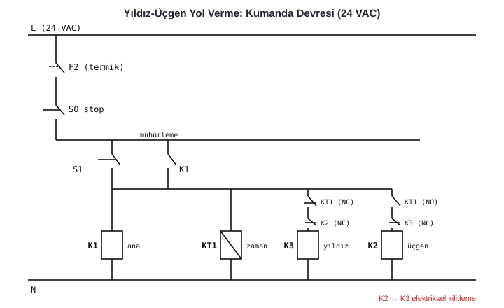

# 07 · EPLAN Electric P8 ile Elektrik Projelendirme ve Kumanda Devreleri

**ONTAS Makina** (tüm makinelerin elektrik projeleri) · **HAUS Centrifuge Technologies** (staj: kumanda devreleri ve EPLAN Harness proD fizibilitesi)



## Yapılan işler
- Makinelerin elektrik projelerini **EPLAN Electric P8** ile baştan sona hazırlamak:
  - Güç devresi, kumanda devresi, PLC I/O sayfaları
  - Klemens planları, kablo listeleri, malzeme listesi (BOM)
  - Pano yerleşim (2D layout)
- **Kumanda devresi** tasarımı ve panoda uygulama: yol verme yöntemleri, kilitlemeler, acil stop zinciri
- Pano montajından sonra devreye alma ve arıza bulma
- HAUS stajında **EPLAN Harness proD** lisansı için fizibilite ve amortisman çalışması

## Tipik EPLAN proje sayfa yapısı
```
=Makine
 ├── +Kapak, İçindekiler, Revizyon
 ├── +Güç Dağıtımı      (ana şalter, sigortalar, 24VDC güç kaynağı)
 ├── +Motorlar          (kontaktör/sürücü güç devreleri)
 ├── +Kumanda           (acil stop, emniyet rölesi, start/stop)
 ├── +PLC               (DI / DO / AI / AO kartları, her kanal ayrı)
 ├── +Klemensler        (X1, X2 ... klemens planları)
 ├── +Kablo Listesi
 ├── +Pano Yerleşim
 └── +Malzeme Listesi (BOM)
```

## Şemadaki yıldız-üçgen kumanda mantığı
1. **S1 (start)** → K1 (ana) ve K3 (yıldız) çeker. Motor yıldızda kalkar.
2. Zaman rölesi **KT1** süresi dolunca K3 bırakır, **K2 (üçgen)** çeker.
3. K2 ile K3 arasında **elektriksel kilitleme** var (NC kontaklar), ikisi aynı anda çekemez.
4. **S0 (stop)**, termik **F2** ve acil stop zinciri tüm devreyi keser.
