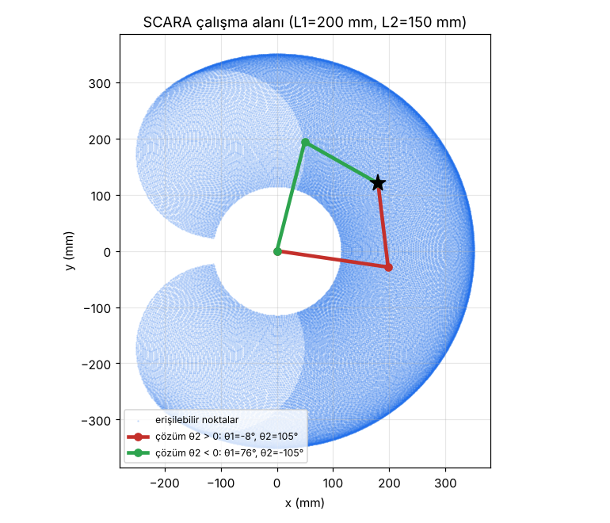

# 08 · Üniversite Projeleri ve Topluluk Çalışmaları

**Afyon Kocatepe Üniversitesi, Mekatronik Mühendisliği (2017-2021)**

| Tarih | Proje | Kısa açıklama | Kod |
|---|---|---|---|
| Ekim 2019 | **CoreXY 3D yazıcı** | CoreXY kinematiğiyle çalışan 3D yazıcının tasarımı ve montajı | [`kod/corexy.py`](kod/corexy.py) |
| Aralık 2019 | **V çizim robotu (V-plotter)** | Duvara asılı, iki ipli çizim robotu | [`kod/v_plotter.py`](kod/v_plotter.py) |
| Ocak 2020 | **SCARA robot kol** | 2 eksenli SCARA kolun tasarımı ve ileri/ters kinematikle programlanması | [`kod/scara_kinematik.py`](kod/scara_kinematik.py) |
| Şubat 2020 | **IoT Teknoloji Hackathonu** | Katılımcı | - |
| Mayıs 2021 | **S7-1200 Konveyör SCADA** | TIA Portal + WinCC simülasyonu | [01 klasörü](../01_SCADA_Konveyor_S7-1200) |
| Haziran 2021 | **Teknofest Otonom İHA Yarışması** | Takım üyesi | - |

**Topluluklar:** Yazılım ve Ekonomi Topluluğu Yönetim Kurulu (2018) · Robot Teknolojileri Topluluğu Yönetim Kurulu (2019)

## SCARA çalışma alanı
`python kod/scara_kinematik.py` ile oluşturulur:

## Kinematik özetleri
**CoreXY:** İki motor (A, B) birlikte X ve Y hareketini oluşturur.
`A = X + Y`, `B = X − Y` → `X = (A + B)/2`, `Y = (A − B)/2`

**V-plotter:** Motorlar arası mesafe D, kalem konumu (x, y):
`L1 = √(x² + y²)`, `L2 = √((D − x)² + y²)`

**SCARA (2R):** Kol boyları L1 ve L2:
`cos θ2 = (x² + y² − L1² − L2²) / (2·L1·L2)`, `θ1 = atan2(y, x) − atan2(L2·sin θ2, L1 + L2·cos θ2)`
